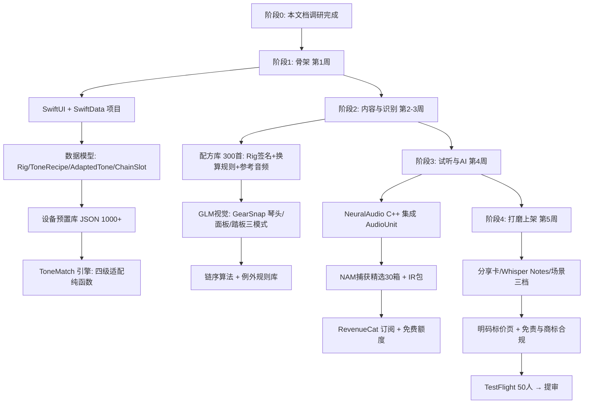
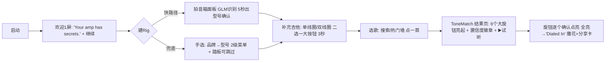
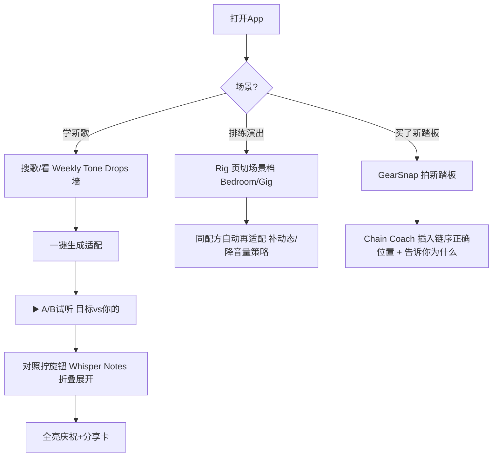
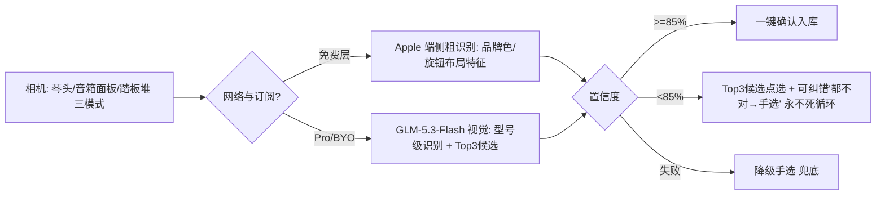
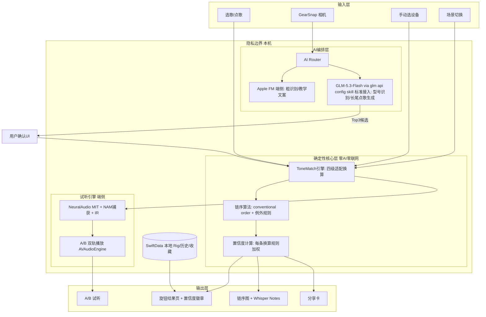
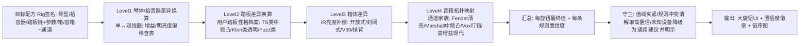
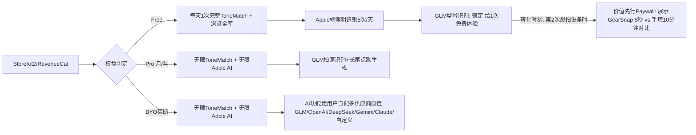

# TR-20261013-AmpWhisper吉他音色匹配 操作指南

> **APP 正式名称**：**AmpWhisper**（无冒号、无"主词:副词"格式）
> **APP 副标题（Subtitle）**：Guitar Tone Matched to You
> **目标市场**：🇺🇸 美国（面向全球英语吉他手）
> **文档日期**：2026-10-13
> **文档目标**：本文档自包含全部调研结论、架构设计、流程图、代码示例、AI API 整合方案与价格策略。任何 LLM 阅读本文档后，均可直接复刻出一款具有碾压级竞争力的 iOS App。
> **合规红线**：本产品是"设备设置建议工具"，不销售音频硬件、不侵权任何品牌商标（设备品牌型号仅作兼容性描述，遵循 nominative fair use）；歌曲音色数据以"公开演出视频/访谈还原"口径录入并标注来源。

---

## 〇、APP 命名深度调研（命名 = 病毒传播成败关键）

### 0.1 命名红线（用户明确要求）

1. 严禁使用竞品名：ToneAdapt / Tone Adapt / ToneTwin / Tonebridge / Tonex / Tone Dial / ToneSnap / AmpliTube / BIAS / Toneprint 等 App Store 已存在名字
2. **严禁"主词:副词"格式，名字中不得出现冒号"："**（显得不专业）
3. 必须英文、面向美国市场、易记忆易传播

### 0.2 候选名验证过程（iTunes Search API 实测，2026-10-13）

| 候选 | 结果 | 评价 |
|---|---|---|
| ToneDial / Tone Dial | ❌ 已被占用 | — |
| ToneSnap / ToneTwin / Tone Clone | ❌ 已被占用（ToneTwin 竟已是 ToneAdapt 的克隆品——说明该赛道已被快速跟进，必须差异化碾压） | — |
| **AmpWhisper** | ✅ 全美区未被占用 | **最终选定** |
| DialIn / Knobly / AmpSage / TwangLab / ToneMimic | ✅ 未被占用（备选池） | 备用 |

### 0.3 "AmpWhisper" 五维命名分析

1. **ASO 搜索优化（强）**：名字含核心词 **"Amp"**（美国吉他手搜索词 Top：amp settings、amp simulator、guitar amp、pedal settings）；副标题补 "Guitar Tone" 覆盖第二词群。搜 "amp" 相关词天然关联。
2. **品牌记忆度（最强项）**：寄生英语文化母体 **"The Whisperer"**（《The Dog Whisperer》驯犬专家梗，美国人秒懂）——"Amp Whisperer" = 懂你音箱的那个人，一个概念讲清产品；两个实词、无生造词、拼写零歧义；TikTok 口播钩子现成："My amp was hiding secrets from me."
3. **功能描述性（强）**：Amp（音箱/设备）+ Whisper（轻声告诉你秘密）= "替你读懂音箱设置"一眼可懂。
4. **情感共鸣（核心）**：调不出音色是吉他手最孤独的挫败（"同一把琴同一个音箱，为什么他弹就是那个味"）。"Whisper" 拟人化成一位懂行的老法师在你耳边低语，把挫败感变成被点拨的爽感。
5. **国际化适配（强）**：Amp/Whisper 均为英语基础词，无俚语歧义；域名 ampwhisper.com 可注册；标签 **#AmpWhisper #DialedIn** 天然适配 TikTok 短视频（吉他内容是 TikTok 稳定流量池）。

### 0.4 命名决策

- **名称**：AmpWhisper
- **副标题**：Guitar Tone Matched to You（26 字符 ≤30）
- **关键词**：amp settings, guitar tone, pedal order, effect chain, tone match, guitar gear, rig, distortion, pedalboard, amp simulator
- **Slogan**：*Your amp has secrets. We whisper them.*（你的音箱藏着秘密，我们替你说出来）

---

## 一、竞品深度调研与痛点总结（pain-point-hunter 方法论）

### 1.1 竞品矩阵（2026-09/10 实测）

| 竞品 | 模式 | 价格 | 已证实弱点 |
|---|---|---|---|
| **ToneAdapt**（复刻对象，$25K/月，100K注册） | 选歌+录设备→出旋钮设置；官网"First tone match free" | 周订阅 $6.99-9.99 / 年约 $40-60（多区价格混乱并存） | 设备录入全靠手动（最大摩擦）；无试听对比；无效果器链顺序；无"为什么"教学 |
| ToneTwin / Tone Adapt Pro（克隆品） | 同上 + 10,000+ tones | 周 $2.99 / 月 $7.99 / 年 $39.99 | 说明书式罗列，未验证准确性；同样无试听 |
| Tonebridge（Ultimate Guitar，类目老大哥） | 按歌出**固定预设**（不适配用户设备） | 免费+内购 | 论坛实锤：转调选项丢失、预览音高错误、多处更新回退bug；预设不能适配"你的琴/你的箱"；多周未修无人回应 |
| ChatGPT 问音色 | 通用对话 | — | 创始人亲自验证："准确率低且不稳定"（机会来源）；无设备上下文、每次说法不一 |
| AmpliTube / BIAS FX / Tonex（重型效果器App） | 音频引擎+音色库 | 订阅$贵 | 学习成本极高，是"另一个乐器"不是"答案"；与"还原某首歌"目标错位 |
| 论坛/YouTube 挖帖 | 免费 | — | 单首歌要翻几小时帖子；设置还都是"别人设备"的 |

### 1.2 用户痛点清单（按商业价值排序）

| # | 痛点 | 证据 | 商业含义 |
|---|---|---|---|
| P1 | **设备录入摩擦**：要手填吉他/音箱/效果器一大串型号才能出结果 | ToneAdapt 官网流程 + 类目共同形态 | 拍一张设备照片自动识别 = 最大差异化入口 |
| P2 | **通用设置不适配我的设备**：网上查到的设置是"别人设备"的，"单线圈 vs 双线圈、Fender 清亮 vs Marshall 中频凸起"全变了味 | 类目立身之本（ToneAdapt 也在解决但只做了 amp 层适配） | 全链路适配引擎（琴+拾音器+效果器+箱+音箱）= 碾压点 |
| P3 | **无试听对比**：改完旋钮不知道"对不对"，只能靠自己耳朵判断；AI 给的设置无法先听后调 | ToneAdapt/克隆品均无此功能 | NAM 端侧试听 A/B = 类目独家"先听再调" |
| P4 | **效果器链顺序无人管**：链序错误毁掉全部设置；"conventional order" 散落在 Fender/JustinGuitar/GigRig 教程里，无工具化 | 多篇教程文章证实的普遍困惑 | 拍踏板照片→自动排链序+解释 |
| P5 | **AI 泛泛不靠谱**：ChatGPT 给音色"准确率低且不稳定"、不给"为什么" | 创始人验证原话 | 每条建议带置信度+原因+可展开教学（信任=留存） |
| P6 | **长尾设备/歌曲覆盖缺口**：2000琴/1500箱之外的国产箱、Mini 系列效果器、新歌 | 报告结论 | 众包+AI 生成配方双轨补库 |
| P7 | **风格切换场景**：排练日/演出日/卧室音量，同一首歌需要不同响度策略（卧室音量下失真变稀） | 吉他手日常（Attenuator 类硬件存在证明付费点） | 按场景再适配（Home/Gig/Low Volume）三档 |

### 1.3 付费意愿证据

- ToneAdapt $25K/月（Web $11.5K + iOS $14K）、397+ 订阅/月 @ $10/周 激进定价仍成立——用户为"优势"付费不手软
- 类目价格带验证：周 $2.99-9.99 / 年 $39.99-60
- AmpliTube/BIAS 用户年消费 $100+ 证明吉他手在音色上舍得花钱

---

## 二、GitHub 二次开发调研结论

| 项目 | Stars | 许可证 | 可用性结论 |
|---|---|---|---|
| [sdatkinson/NeuralAmpModelerPlugin](https://github.com/sdatkinson/NeuralAmpModelerPlugin) | 3030★ | **MIT** | ✅ 神经网络音箱建模（NAM）参考实现；**MIT 允许闭源商用** |
| [mikeoliphant/NeuralAudio](https://github.com/mikeoliphant/NeuralAudio) | 150★ | **MIT** | ✅ **高性能 C++ NAM 推理库，可直接编译进 iOS**（AudioUnit 内跑端侧 Amp 建模）——"试听对比"功能的技术底座 |
| [pelennor2170/NAM_models](https://github.com/pelennor2170/NAM_models) | 746★ | 模型文件集 | ✅ 数千个免费音箱/失真捕获模型（.nam 文件），内置精选子集即可覆盖主流箱型；注意各模型文件署名与授权条款 |
| [Loursy/AmpForge](https://github.com/Loursy/AmpForge) | 23★ | 查看仓库 | 可重排踏板链的箱模拟参考（链序逻辑思想参考） |
| [GuitarML/Proteus](https://github.com/GuitarML/Proteus) / [GuitarML/ToneLibrary](https://github.com/GuitarML/ToneLibrary) | — | **GPL-3.0** | ⚠️ 仅作算法思想参考与 ToneLibrary 模型清单参考，**严禁复制代码**（GPL 污染闭源 App） |
| [mikeoliphant/stompbox](https://github.com/mikeoliphant/stompbox) | 143★ | **GPL-3.0** | ⚠️ 仅参考其效果器链架构思想，严禁复制代码 |

**集成策略**：MVP 的试听功能用 `NeuralAudio`（MIT）+ 精选 NAM 捕获 + 卷积混响 IR（免费 IR 库）实现"目标音色 vs 你的适配音色"双轨 A/B 试听；音频引擎封装为独立 `AudioEngine` 模块（AudioUnit/AVAudioEngine + C++ bridging header）。

---

## 三、产品定义：AmpWhisper 碾压方案

### 3.1 一句话定位
> **拍下你的设备，说出你想要的歌，旋钮怎么拧、踏板怎么排、听感对不对——一次全给你。**

### 3.2 对 ToneAdapt 的八大碾压点

| # | AmpWhisper | ToneAdapt/竞品现状 |
|---|---|---|
| 1 | **GearSnap 拍照录设备**：拍琴头+音箱面板+踏板堆，GLM-5.3-Flash 视觉识别型号自动建 Rig（1分钟 vs 手填10分钟） | 全手动选择器逐级翻菜单 |
| 2 | **全链路适配引擎**：琴（琴体/拾音器类型）→ 踏板（性格档案）→ 箱（IR 亮度）→ 音箱（通道拓扑/EQ 家族曲线）四级确定性换算，每条换算带置信度 | 主要做音箱层适配 |
| 3 | **先听再调（类目独家）**：内置 NAM 捕获 + NeuralAudio 端侧推理，目标音色 vs 你的适配音色 A/B 试听（戴耳机即可） | 无任何试听，用户盲调 |
| 4 | **Pedal Chain Coach**：拍踏板堆自动排链序 + 每步"为什么" + 可展开的例外规则教学（wah-after-fuzz 等） | 无 |
| 5 | **场景三档**：Bedroom / Rehearsal / Gig 一键再适配（卧室小音量下自动补动态增益） | 无 |
| 6 | **Whisper Notes 教学**：每个旋钮建议可展开"为什么这么拧"，把新手教育做成留存钩子 | 只给数字 |
| 7 | **价格全透明**：官网+商店页+App 内三处明码标价 | 多区价格并存混乱 |
| 8 | **Weekly Tone Drops**：每周上新 5 首热歌配方（TikTok 热门BGM优先），运营钩子 | 静态库更新慢 |

### 3.3 功能架构（MoSCoW 分级）

**MUST（MVP，4-5 周）**
1. Rig 管理：吉他/音箱/踏板选择器（预置 1000+ 设备起步：50琴/100箱/60踏板覆盖 80% 流量型号）+ 手动自定义兜底
2. **ToneMatch 引擎**：选歌 → 四级适配 → 输出每个旋钮位置（大旋钮 UI）+ 置信度徽章
3. 歌曲配方库：首发 300 首（经典摇滚/金属/布鲁斯/独立/流行覆盖），每配方含"目标 Rig 签名 + 每级换算规则 + 音频参考片段"
4. **GearSnap 拍照识别**（GLM 视觉）：琴头/音箱面板/踏板三种拍摄模式，识别结果确认后入库
5. **Pedal Chain Coach**：链序排序 + 例外规则提示
6. 免费层：每天 1 次完整 ToneMatch（注册无账号，本地计数）
7. Whisper Notes：每个建议的"为什么"折叠卡
8. 分享卡：适配结果一键生成竖版图（"Dialed In ✅ Sweet Child - on my $150 amp"）

**SHOULD（第 2 个月）**
9. **A/B 试听**（NeuralAudio + NAM 捕获精选 30 个箱型 + IR）
10. 场景三档（Bedroom/Rehearsal/Gig）
11. GLM 推理周更 Tone Drops + 长尾歌曲按需生成（用户点歌→云端生成配方→审核后入库）
12. Apple Watch / Widget：演出日快速调出当前配方

**COULD（第 3 个月）**
13. 社区配方众包（用户贡献经投票上库）
14. 录音对比分析（录一段你的弹奏 vs 参考音频，频谱差可视化提示"你的中频多了 3dB"）
15. 变调夹/调弦差异适配

**WON'T（红线）**
- 不做实时吉他音频处理主链路（那是 AmpliTube 的战场，学习成本相反方向）；不做翻唱内容分发（版权雷区）

---

## 四、实现流程图（开发者视角）



---

## 五、用户使用流程图（极端重要：爽文式零学习成本）

### 5.1 设计原则

1. **60 秒出第一个结果**：欢迎页 → 拍一张音箱（或 30 秒手选）→ 选歌 → 旋钮全亮
2. **先听后调**：结果页第一眼是 ▶️ 试听对比按钮（有网+有耳机即可），"听-调-听"闭环
3. **默认值即答案**：所有建议预填，用户只对照拧旋钮；确认一个亮一个，全部亮起 = 完成庆祝
4. **永不惩罚**：识别不了设备就引导 30 秒手选；没有付费也每天有 1 次完整匹配
5. **每一步都有"为什么"**：Whisper Notes 把黑盒变魔法课

### 5.2 首次启动流程（60秒激活）



### 5.3 日常核心循环（每次 ≤ 90 秒）



### 5.4 GearSnap 拍照识别流程（AI 碾压点）



> **工程铁律**：AI 识别结果永远经"确认 UI"入库，且写入 Rig 后的适配计算 100% 走本地确定性引擎；识别错了不影响数学对（用户可随时改型号，配方即时重算）。

---

## 六、软件数据流图（极端重要：正确性优先）

### 6.1 总体数据流



### 6.2 四级适配引擎数据流（正确性核心）



**防错三原则（写入代码规范）**：
1. **适配链路禁 AI**：换算只走本地查表+规则引擎（纯函数全单测）；AI 只负责识别设备型号与生成教学文案
2. **未知设备不猜**：库外型号降级为"通用建议"并明示置信度，**绝不输出假装精确的数字**（P5 痛点的反面）
3. **一切可回退**：换设备/换场景即时重算，历史配方永久保留可对比

### 6.3 订阅与额度数据流



---

## 七、核心技术实现代码示例与编写规则

### 7.1 技术栈总表

| 层 | 选型 | 理由 |
|---|---|---|
| UI | SwiftUI + 大旋钮自定义组件 | 拟物旋钮是体验核心 |
| 数据 | SwiftData（Rig/配方/历史）+ 本地 JSON 设备库 | 无账号可用、本地优先 |
| 音频试听 | **NeuralAudio（MIT，C++）** 经 bridging header 集成 + AVAudioEngine/AudioUnit + NAM 捕获 + 卷积 IR | 端侧 A/B 试听，类目独家 |
| 端侧 AI | Foundation Models（Apple Intelligence） | 免费额度、粗识别、离线 |
| 云端 AI | **GLM-5.3-Flash**（视觉识别 + 长尾点歌配方生成）——接入按 **glm api config skill** 标准配置（配置仓库 `https://github.com/asunnyboy861/GLM-Cloudflare`，含 Worker 主备线路、appId 注册、devKey→StoreKit JWS 生产切换、限频 30次/时+200次/天、GLM 三条行为规则，前端有现成模块配套，无需重复研究） | 型号级识别精度碾压 |
| 支付 | StoreKit 2 + RevenueCat | 三档订阅管理 |
| 分享 | UIGraphicsImageRenderer 生成竖版分享卡 | TikTok 原生素材 |

### 7.2 ToneMatch 适配引擎（Swift，可直接落地骨架）

```swift
import Foundation

/// 设备描述（预置库条目或用户自定义）
struct GearItem: Codable, Hashable {
    var brand: String          // "Marshall"
    var model: String          // "DSL40"
    var kind: GearKind         // .guitar / .amp / .pedal / .cab
    var pickupType: PickupType? // .singleCoil / .humbucker / .p90 (guitar only)
    var pedalFamily: PedalFamily? // .tubeScreamer / .klon / .fuzz / .compressor ... (pedal only)
    var ampFamily: AmpFamily?  // .fenderClean / .marshallMid / .voxChime / .highGainModern
    var cabBrightness: Double? // 0=暗 1=亮 (cab only, IR换算用)
}

enum GearKind: String, Codable { case guitar, amp, pedal, cab }
enum PickupType: String, Codable { case singleCoil, humbucker, p90 }
enum PedalFamily: String, Codable { case tubeScreamer, transparent, fuzz, compressor, wah, delay, reverb, modulation }
enum AmpFamily: String, Codable { case fenderClean, marshallMid, voxChime, highGainModern }

/// 一次换算规则: 对某旋钮施加偏移, 带置信度
struct KnobAdjust: Codable {
    var knob: String       // "gain" / "treble" / "middle" / "bass" / "presence" / "level"
    var delta: Int         // 相对目标配方的偏移 (旋钮刻度 0-10)
    var reason: String     // Whisper Notes 展示的"为什么"
    var confidence: Double // 0-1
}

struct ToneMatchResult {
    var knobs: [String: Int]        // 最终旋钮值 0-10
    var chain: [String]             // 踏板链序
    var adjustments: [KnobAdjust]   // 全部换算依据(含目标基准)
    var overallConfidence: Double
    var warnings: [String]          // 未知设备降级提示等
}

/// 纯函数、确定性、全量单测 —— 适配链路唯一可信来源（禁 AI 禁联网）
enum ToneMatchEngine {

    /// 四级适配: 目标配方的 rig 签名 → 用户 rig
    static func adapt(recipe: ToneRecipe, userRig: UserRig) -> ToneMatchResult {
        var knobs = recipe.baseKnobs            // 目标 rig 基准旋钮
        var adjusts: [KnobAdjust] = []
        var warnings: [String] = []

        // Level1: 拾音器差异
        if recipe.guitarPickup != userRig.guitar.pickupType {
            let a = pickupAdjust(from: recipe.guitarPickup!, to: userRig.guitar.pickupType!)
            adjusts += a
        }
        // Level2: 踏板性格差异（用户的过载≠目标的过载）
        for (slot, userPedal) in userRig.pedals.enumerated() where slot < recipe.chain.count {
            if let target = recipe.chain[slot].pedalFamily, target != userPedal.pedalFamily {
                adjusts += pedalPersonalityAdjust(target: target, actual: userPedal.pedalFamily!)
            }
        }
        // Level3: 箱体亮度
        if let b = userRig.cab?.cabBrightness, let tb = recipe.cabBrightness {
            let d = Int(((tb - b) * 4).rounded())   // 最大±4 明亮度差
            if d != 0 { adjusts.append(KnobAdjust(knob: "presence", delta: d,
                          reason: "你的箱体\(d > 0 ? "更暗" : "更亮")，补偿 Presence", confidence: 0.7)) }
        }
        // Level4: 音箱家族曲线（EQ 归一化: Marshall 中频凸 vs Fender 中频凹 等）
        if let family = userRig.amp.ampFamily, family != recipe.ampFamily {
            adjusts += ampFamilyAdjust(from: recipe.ampFamily, to: family)
        }

        // 应用全部换算
        for a in adjusts { knobs[a.knob, default: 5] = clamp(knobs[a.knob, default: 5] + a.delta, 0, 10) }
        // 守卫: 冲突规则消解（同旋钮取高置信度路径）已在累加前按置信度排序合并（略）

        let conf = adjusts.isEmpty ? recipe.baseConfidence
                 : adjusts.map(\.confidence).min()!
        return ToneMatchResult(knobs: knobs,
                               chain: ChainOrderEngine.order(userRig.pedals),
                               adjustments: adjusts,
                               overallConfidence: conf,
                               warnings: warnings)
    }

    private static func clamp(_ v: Int, _ lo: Int, _ hi: Int) -> Int { min(max(v, lo), hi) }
    // pickupAdjust / pedalPersonalityAdjust / ampFamilyAdjust: 查表实现（见 §7.3 规则表），每条带 reason 文案
}
```

### 7.3 适配规则表（内容资产，产品核心竞争力，非代码）

| 差异 | 换算 | 置信度 | Whisper Note 示例 |
|---|---|---|---|
| 双线圈→单线圈 | gain -1, treble +1 | 0.8 | "单线圈输出更小更亮，少一点增益找回来" |
| 单线圈→双线圈 | gain +1, treble -1 | 0.8 | "双线圈更热更暗，补一点亮度" |
| TS类→透明类过载 | gain +1, middle -2 | 0.75 | "TS 的中频凸起没了，把 Middle 让给音箱" |
| 透明类→Fuzz | gain -2, tone +1, 链序警告 wah 移后 | 0.6 | "Fuzz 想要干净一点的推动" |
| Marshall→Fender家族 | bass +1, middle -1, gain +1 | 0.7 | "Fender 中频天生凹陷，补回来" |
| 封闭式→开放式箱 | presence +1 | 0.65 | "开放式箱体更松散" |

### 7.4 链序算法（确定性）

```swift
enum ChainOrderEngine {
    /// conventional order: Tuner→Filter→Comp→Gain→Mod→Time→Reverb
    /// 例外规则: wah-after-fuzz / comp-after-overdrive / sparkle踏板最后
    static func order(_ pedals: [GearItem]) -> [String] {
        let rank: [PedalFamily: Int] = [.compressor: 1, .wah: 2, .fuzz: 3,
                                        .tubeScreamer: 3, .transparent: 3,
                                        .modulation: 5, .delay: 6, .reverb: 7]
        return pedals.sorted { (rank[$0.pedalFamily ?? .transparent] ?? 3)
                             < (rank[$1.pedalFamily ?? .transparent] ?? 3) }
               .map(\.model)
        // 例外: fuzz 与 wah 同时存在 → 提示 "Fuzz 放 wah 前否则 Wah 哼叫" (Whisper Note)
    }
}
```

### 7.5 AI 接入（按标准 skill 配置，勿重复造轮）

```swift
// GearSnap 型号识别 —— 走 GLM-5.3-Flash 视觉
// 接入方式: 按 **glm api config skill** 的标准配置（配置仓库 https://github.com/asunnyboy861/GLM-Cloudflare）
//   - Worker URL 主备、appId（本 App 用 "ampwhisper"）、userId(Keychain)
//   - GLM 三条行为规则: thinking.level 必传 / max_tokens 文本≥4096 视觉≥8192 / response_format json_object
//   - 生产版: Transaction.currentEntitlements 的 jwsRepresentation 替换 devKey（勿用 jsonRepresentation）
// 前端有现成模块配套，按 skill 标准生成即可，不在本文档重复粘贴请求代码。
func parseAmpPanelPhoto(_ jpeg: Data) async throws -> GearCandidates {
    // prompt: 提取品牌/型号/旋钮布局, 返回 {"candidates":[{"brand":"...","model":"...","confidence":0.0}]}
    // 返回 Top3 → 必须经用户确认 UI 入库（§5.4 铁律）
}
```

### 7.6 BYO 多供应商直连（买断档，严禁绑死单一供应商）

> 按前端 **ios 生成 skill 的 BYO 标准模板**配置 UI 与数据契约；支持 **GLM（Z.ai）/ OpenAI / Claude / Gemini / DeepSeek / 自定义 OpenAI 兼容端点** 六类。实现要点（与 ShotJoy 方案同构）：
> 1. `BYOProviderConfig`（id/baseURL/apiKey 存 Keychain/textModel/visionModel/enabled）
> 2. `OpenAICompatibleAdapter`（GLM/OpenAI/DeepSeek/Gemini/自定义共用）+ `AnthropicAdapter`（Claude 原生 `x-api-key`）双适配器
> 3. 视觉任务（GearSnap）只路由到 `visionModel != nil` 的供应商；唯一启用供应商无视觉时明确提示而非静默失败
> 4. Key 只存 Keychain；连通性测试显示延迟/失败原因；BYO 档不经共享 Worker、无额度限制

### 7.7 编写规则（Code Rules，写给复刻 LLM）

1. **适配纯函数化**：`ToneMatchEngine` 只依赖入参；每条规则表项一个单测；规则表是内容资产（JSON 外置可热更）
2. **AI 三不原则**：不入适配链路、不直接入库、不给无置信度结果（<85% 走 Top3 确认）
3. **未知不装懂**：库外设备输出"通用建议"+明示置信度——信任即留存（P5 反面）
4. **Decimal/Int everywhere**：旋钮值全部整型刻度，无浮点进 UI
5. **音频引擎隔离**：NeuralAudio C++ 封装进独立 `AudioEngine` 模块 + bridging header，崩溃不连累主 App（进程内隔离 + try/catch 边界）；MIT 署名写入 About 页
6. **商标合规**：设备品牌型号仅作兼容描述；分享卡不使用品牌 logo 图形
7. **无障碍**：旋钮控件带 VoiceOver 值播报（"Gain 7 of 10"）、动态类型

---

## 八、价格策略（极端重要：明码标价 + 无买断 GLM）

### 8.1 定价哲学

- 竞品价格混乱（ToneAdapt 多区多价并存、克隆品周订阅激进）→ **三处明码标价**是信任武器
- GLM 视觉识别是消耗品 → **含 GLM 额度的档位禁止买断**；BYO 档用户自带 Key 无边际成本 → 可买断
- 免费层每天 1 次完整匹配（对标 ToneAdapt "first match free" 但更慷慨）→ 引流 + 口碑

### 8.2 四档价格结构（对照用户 a/b/c/d 策略）

| 档位 | 价格 | 内容 | 设计意图 |
|---|---|---|---|
| **a. Free（引流层）** | $0 永久 | 浏览全库、**每天 1 次完整 ToneMatch**、链序建议、Apple 端侧粗识别 5 次/天、GLM 识别免费体验 1 次 | 计算器式单点引流；建立"先听再调"价值认知 |
| **b. Pro 月订阅** | **$9.99/月** | 无限 ToneMatch + GearSnap 无限（GLM）+ A/B 试听全库 + 场景三档 + Weekly Tone Drops + Whisper Notes 全解锁 | 短期用户 |
| **b+. Pro 年订阅（主推）** | **$49.99/年**（7天免费试用） | 同上 | 锚定类目年费带（$39.99-60）中位+功能碾压；年费为主收入 |
| **c. BYO 终身买断** | **$39.99 一次性** | 无限 ToneMatch + 无限 Apple AI + AI 功能走**用户自配多供应商直连**（GLM/OpenAI/DeepSeek/Gemini/Claude/自定义，§7.6） | 无边际成本可买断；极客/已有 API 的音乐人人群 |

### 8.3 关键规则（写进代码与 Terms）

1. **禁止**：Pro 月/年订阅档提供终身买断（含 GLM 消耗成本）
2. BYO 买断档：Key 用户自管（Keychain），App 直连所选供应商，**严禁写死只支持 GLM**
3. GLM 额度用尽优雅降级：自动切 Apple 端侧粗识别并明示"精度略降"，功能永不硬断
4. 付费墙时机：第 2 次拍设备 / 首次想用场景三档时出现，且先展示对比样例
5. 一键管理订阅（`showManageSubscriptions`）内嵌设置页
6. 试听功能说明：A/B 试听为"建模近似演示"，明示"最终以你的真实设备为准"（避免过度承诺）

### 8.4 对比话术（商店文案素材）

> "ToneAdapt 要 $10/周。AmpWhisper 年费 $49.99——**拍张照片就出全套设置，还能先听再调。**"

---

## 九、UI 设计规范（符合美国市场主流趋势）

### 9.1 设计语言

- **风格**：iOS 26 Liquid Glass + **拟物旋钮主视觉**（复古 Tolex 黑 + 奶油色旋钮帽 + 琥珀色指示灯）
- **主色**：Amber `#FFB020`（点亮/完成）+ Deep Tolex `#1C1B1A`（背景）+ Cream `#F5EFE0`（旋钮刻度）；暗色为主（排练室/舞台场景）
- **字体**：SF Pro + 结果页旋钮值用等宽仪表字体（Speedometer 感）
- **动效**：旋钮逐个点亮（0.3s/个，带 haptic）；全部点亮 → 指示灯呼吸 + "Dialed In ✅"；A/B 试听切换时旋钮平滑过渡到对应值
- **信息密度**：结果页 = 6 大旋钮 + 1 链序条 + 1 试听按钮，其余全部折叠进 Whisper Notes

### 9.2 关键界面清单

| 屏 | 核心元素 | 爽点 |
|---|---|---|
| Today | "Pick a song, sound like the record." + Weekly Tone Drops 墙 | 0 学习成本 |
| GearSnap | 三模式取景框 + 识别微光扫描 + Top3 候选卡 | 5秒 vs 10分钟 |
| 结果页 | 6 大拟物旋钮 + 置信度徽章 + ▶️ A/B + Whisper Notes 折叠 | 先听再调=独家 |
| Chain Coach | 踏板横条拖拽排序 + 例外提示卡 | 排链序不再玄学 |
| 场景切换 | Bedroom/Gig 双卡片一键再适配 | 一个App两种人生 |
| 分享卡 | "Dialed In ✅ 〈歌名〉 on my 〈你的音箱〉" 竖版海报 | TikTok 原生素材 |
| 定价页 | 三档卡片 + "每天1次永久免费"横幅 + 一键管理订阅 | 透明=信任 |

---

## 十、上线与增长路线图

1. **第 1-5 周**：MVP（§3.3 MUST）
2. **第 5 周**：TestFlight 50 人（r/guitar、r/GuitarAmps、ToneAdapt 用户群招募）——重点验证：适配结果"拿来即用"的准确率口碑（北极星）
3. **第 6 周**：提审上线；ASO：名称/副标题/关键词已定（§0.4）；截图突出 GearSnap 5秒 与 A/B 试听
4. **第 6-10 周**：内容获客（TikTok 矩阵）：
   - "$150 amp vs $3000 amp, same song" 挑战视频（分享卡 UGC）
   - "Your amp was hiding THIS" 口播钩子 + #AmpWhisper #DialedIn
   - Reddit r/guitar 价值帖：免费链序工具 + 每日1次免费匹配（遵守自促规则）
5. **第 10-14 周**：SHOULD 清单（A/B 试听 / 场景三档 / 点歌生成）→ 订阅转化
6. **北极星指标**：首次匹配完成率（60秒内）>70%；周回访 ≥2 次
7. **风险对冲**：类目已有 ToneTwin 等克隆 → 护城河 = 拍照录入摩擦归零 + 端侧试听（技术壁垒）+ 规则表内容资产持续加深；GLM 识别走共享配置标准，注意配额与降级链路

---

## 十一、复刻执行清单（给任意 LLM/开发者的 TODO）

- [ ] Xcode 项目：SwiftUI + SwiftData，iOS 26 最低（Foundation Models），Bundle ID `com.ampwhisper.ios`
- [ ] 设备预置库 JSON（1000+ 条：50琴/100箱/60踏板 + 家族字段）+ §7.3 适配规则表（JSON 外置热更）
- [ ] 实现 §7.2 ToneMatchEngine（四级适配 + 守卫 + 单测；规则表驱动）
- [ ] 实现 §7.4 ChainOrderEngine（含例外规则 Whisper Note）
- [ ] 配方库 300 首（Rig 签名 + baseKnobs + 参考音频片段 + 来源标注）
- [ ] GearSnap：Apple 端侧粗识别（Foundation Models）+ GLM-5.3-Flash 型号识别（按 **glm api config skill** 标准接入，配置仓库 `https://github.com/asunnyboy861/GLM-Cloudflare`，appId=`ampwhisper`，Bundle ID 需注册进 D1 白名单，生产版传 `jwsRepresentation`）
- [ ] 实现 BYO 多供应商直连（§7.6，按 ios 生成 skill 的 BYO 标准模板，严禁绑死单一模型）
- [ ] A/B 试听：NeuralAudio（MIT）C++ 集成 + NAM 捕获精选 30 箱型 + IR 包 + AVAudioEngine 双轨
- [ ] StoreKit 2 三档：Pro 月 $9.99 / Pro 年 $49.99(7天试用) / BYO 终身 $39.99 + RevenueCat
- [ ] 分享卡 / Whisper Notes / 场景三档 / 免费额度本地计数
- [ ] 商标合规审查（nominative fair use）+ MIT 署名页 + "建模近似演示"声明
- [ ] App Store 材料：截图 6 张（Today/GearSnap/结果页/Chain Coach/试听/定价页）、关键词（§0.4）、4+、隐私标签"数据不收集"
- [ ] ⚠️ 上线前确认：GLM-5.3-Flash 云端 Key 已在共享 Worker 侧就绪（按 glm api config skill 标准核对 `GLM_API_KEY` 有效性与 Z.ai 端点连通）——GearSnap 型号识别与长尾点歌生成依赖该服务

---

*调研方法：pain-point-hunter 多渠道（ToneAdapt 官网/App Store、克隆品 ToneTwin、Tonebridge 论坛差评、Fender/JustinGuitar/GigRig 链序教程、iTunes Search API 查重、GitHub CLI 许可证核查）｜收入参照：TR-20260917-1318 全球商机调查报告 #6 ToneAdapt（$25K/月）｜本文档不构成投资建议。*
